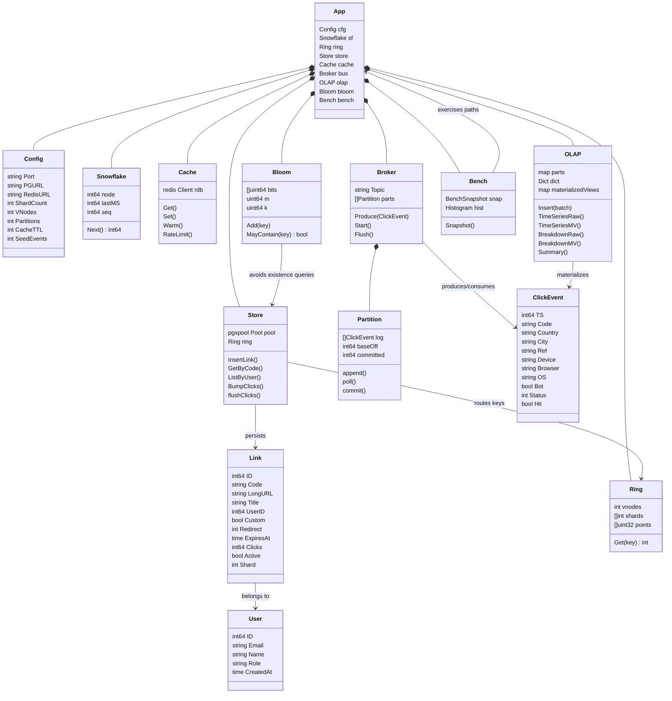
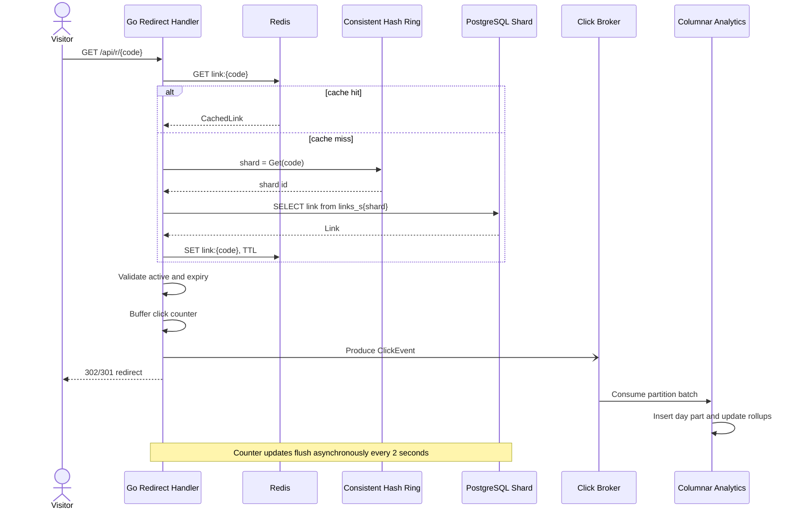
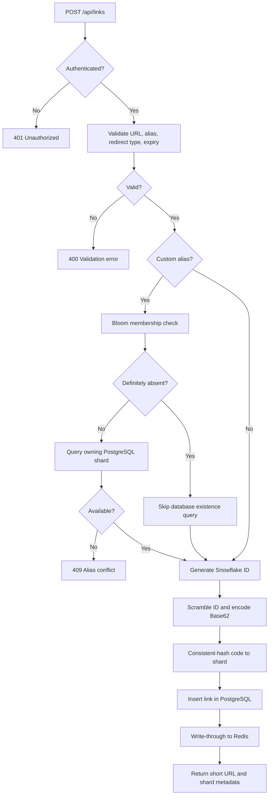
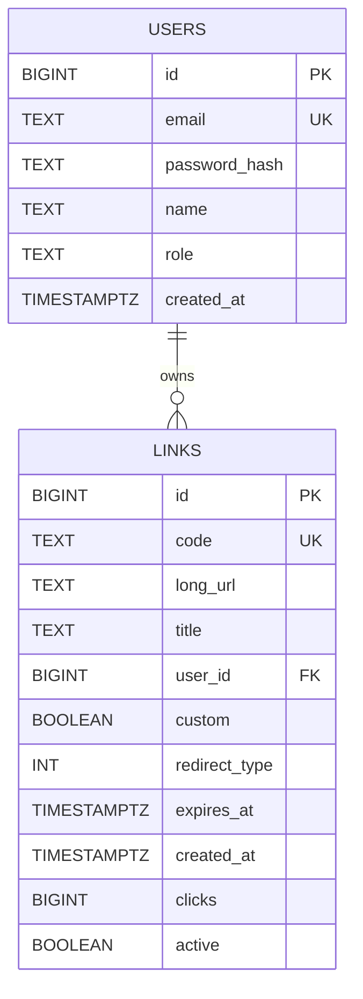

# Kortex

Kortex is a distributed URL-shortening and click-analytics platform. It combines a Redis-first redirect path, PostgreSQL link storage, consistent-hash sharding, asynchronous click-event processing, a columnar analytics engine, and a React operations console.

## System Design Scope

This document maps the implementation to the low-level system-design evaluation criteria.

### Architecture at a glance

```text
React console / browser
          |
          v
   Go HTTP API + router
      |          |
      |          +--> Redis: link cache, rate limits, login lockouts
      |
      +--> Consistent-hash ring --> PostgreSQL links_s0 ... links_s3
      |
      +--> Non-blocking click broker --> partition consumers
                                      |
                                      v
                         columnar day partitions + rollups
```

The default deployment uses four logical PostgreSQL shards, four click-event partitions, Redis 7, PostgreSQL 15, a Go 1.24 backend, and a React 19 frontend. The system is packaged as a multi-stage Docker image and can be started with Docker Compose.

## 1. Requirement Analysis

### Actors

| Actor | Responsibilities |
|---|---|
| Anonymous visitor | Resolve a short code, receive a redirect, or request a QR code. |
| Registered user | Create, list, inspect, disable, delete, and analyze owned links. |
| Operator | Inspect health, cache, shard, broker, runtime, and OLAP statistics. |
| Benchmark client | Generate redirect load or synthetic click events and collect metrics. |
| Background workers | Flush click counters, consume event partitions, merge columnar parts, and maintain rollups. |

### Functional requirements

1. Register and authenticate users with access and refresh tokens.
2. Create short links from HTTP/HTTPS URLs with optional custom aliases, redirect types, titles, and expiry times.
3. Resolve a short code with low latency and return the configured redirect response.
4. Track click events without blocking the redirect response.
5. Expose link-level and account-level analytics by time, geography, referrer, device, browser, operating system, and bot status.
6. Support QR-code generation, link activation/deactivation, deletion, and alias availability checks.
7. Expose operational statistics and an interactive lab for Snowflake IDs, consistent hashing, and Bloom filters.
8. Provide built-in redirect and event-ingestion benchmarks.

### Non-functional requirements

- Low redirect latency: Redis should serve the normal read path; PostgreSQL is the fallback.
- High read throughput: redirects must not synchronously update PostgreSQL.
- Eventual analytics consistency: click counters and analytics may lag redirects by a bounded amount.
- Deterministic partitioning: link ownership must map to exactly one shard.
- Correctness: IDs and short-code mappings must be collision-free and reversible.
- Resilience: event-buffer pressure is bounded and observable; dependency startup is retried.
- Security: passwords are bcrypt-hashed; browser sessions use HttpOnly, SameSite=Lax cookies with single-use rotating refresh tokens; CORS is allowlisted; login and registration are rate limited per client IP; forwarded-for headers are trusted only from configured proxies.
- Operability: cache hit rate, broker lag, dropped events, query timings, runtime memory, and shard distribution are observable.

## 2. Class / Type Diagram

Go does not provide class inheritance. Kortex uses structs for state, methods for behavior, interfaces for polymorphism, and composition for relationships.



### Relationship and multiplicity summary

- One `App` composes one runtime `Config`, `Snowflake`, `Ring`, `Store`, `Cache`, `Broker`, `OLAP`, `Bloom`, and `Bench`.
- One `Broker` owns four or more `Partition` instances, configurable through `BUS_PARTITIONS`.
- One `User` owns zero or more `Link` records.
- Each `Link` is routed to exactly one logical PostgreSQL shard by `Ring.Get(code)`.
- One `ClickEvent` belongs to one short-code stream and is consumed by exactly one broker partition selected by hash.
- `OLAP` stores many click events in day partitions and maintains multiple aggregate maps.

## 3. Object-Oriented Design

### Abstraction

- `rnd` abstracts random-number generation so production request enrichment can use lock-free `math/rand/v2`, while deterministic paths use `math/rand.Rand`.
- HTTP handlers depend on domain operations such as `resolve`, `Store.GetByCode`, `Cache.Get`, and `OLAP.TimeSeriesMV` rather than embedding all storage logic in routes.
- `ClickEvent`, `Link`, `User`, `RingReport`, and benchmark snapshots are explicit domain structures.

### Encapsulation

- Ring internals (`points`, `owner`) are private and accessed through `Get`.
- Cache statistics and broker counters use atomic fields and controlled methods.
- Partition offsets are protected by a mutex and changed through `append`, `poll`, and `commit`.
- Password hashing, token parsing, authorization, and cookie handling are centralized in `auth.go`.

### Inheritance and polymorphism

Go deliberately avoids class inheritance. The equivalent design is interface satisfaction and composition:

- `*rand.Rand` and `fastRand` both satisfy the `rnd` interface.
- HTTP middleware composes CORS, recovery, authentication, and redirect counting.
- Raw-scan and materialized-view analytics implement the same conceptual query operation and are selected by the `mode` request parameter.

## 4. SOLID Principles

| Principle | Application in Kortex |
|---|---|
| Single Responsibility | `Cache` handles Redis, `Store` handles PostgreSQL, `Ring` handles routing, `Broker` handles event delivery, `OLAP` handles analytics, and handlers translate HTTP. |
| Open/Closed | New analytics dimensions can be added through OLAP dimension maps; new benchmark kinds can be added without changing the transport contract. |
| Liskov Substitution | Any implementation of `rnd` can be supplied to request enrichment without changing its behavior contract. |
| Interface Segregation | Small interfaces such as `rnd` avoid forcing callers to depend on unrelated methods. |
| Dependency Inversion | `App` wires dependencies at startup; handlers call domain components instead of managing SQL, Redis protocol, or partition internals. |

## 5. Design Patterns

| Pattern | Where it appears | Why it is used |
|---|---|---|
| Dependency Injection / Composition Root | `main.go` constructs `Config`, `Ring`, `Store`, `Cache`, `Broker`, `OLAP`, and `Bench`. | Centralizes wiring and makes dependencies explicit. |
| Strategy | `mode=raw` versus `mode=mv` analytics execution. | Allows the same endpoint to compare full scans with pre-aggregated queries. |
| Producer-Consumer | `Broker.Produce`, partition dispatch, and partition consumers. | Decouples redirect latency from analytics persistence. |
| Observer / Publish-Subscribe | Redirects publish `ClickEvent` values; consumers react asynchronously. | Allows analytics consumers to evolve independently of redirects. |
| Repository | `Store` methods such as `InsertLink`, `GetByCode`, `ListByUser`, and `DeleteLink`. | Encapsulates SQL and shard-table selection. |
| Cache-Aside | `resolve` checks Redis, falls back to PostgreSQL, then repopulates Redis. | Reduces database reads while retaining PostgreSQL as source of truth. |
| Object Pool | Redis and PostgreSQL connection pools. | Reuses connections and bounds resource consumption. |
| Builder-style Pipeline | `Cache.Warm` uses a Redis pipeline. | Reduces round trips during startup cache warming. |
| Adapter | HTTP handlers adapt JSON requests into domain calls and domain results into JSON. | Separates transport from business logic. |

Kortex does not use a Singleton or inheritance hierarchy because process-wide mutable singletons and class inheritance would make lifecycle, testing, and dependency ownership less explicit in Go.

## 6. Sequence and Activity Diagrams

### Short-link redirect sequence



### Link creation activity



## 7. API / Interface Design

### Public and authentication endpoints

| Method | Endpoint | Purpose |
|---|---|---|
| `POST` | `/api/auth/register` | Create a user. |
| `POST` | `/api/auth/login` | Set access and refresh cookies; body is `{ user }`. |
| `POST` | `/api/auth/demo` | Demo mode only: sign in to the shared non-admin demo account; body is `{ user }`. |
| `POST` | `/api/auth/refresh` | Rotate the refresh token (single use; replays are rejected). |
| `POST` | `/api/auth/logout` | Revoke tokens and clear cookies (works without a valid session). |
| `GET` | `/api/system/stats` | Cache, broker, OLAP, shard, and runtime statistics (cached ~5s). |
| `GET` | `/api/bench/status` | Current benchmark snapshot. |
| `GET` | `/api/lab/*` | Snowflake, consistent-hash, and Bloom-filter playground endpoints (API only; inputs are clamped). |
| `GET` | `/api/health` | Check service and PostgreSQL health. |
| `GET` | `/api/r/{code}` | Resolve a short link and redirect. |
| `GET` | `/api/resolve/{code}` | Resolve a link as JSON (`status`, `active`, `expired`; no destination for disabled/expired links). |
| `GET` | `/api/qr/{code}` | Generate a 512px PNG QR code. |

### Authenticated link and analytics endpoints

| Method | Endpoint | Purpose |
|---|---|---|
| `POST` | `/api/links` | Create a link. |
| `GET` | `/api/links` | List links owned by the current user. |
| `GET` | `/api/links/check-alias?alias=x` | Validate alias availability. |
| `GET` | `/api/links/{code}` | Get link details. |
| `POST` | `/api/links/{code}/toggle` | Enable or disable a link. |
| `DELETE` | `/api/links/{code}` | Delete an owned link. |
| `GET` | `/api/analytics/overview?range=` | Account-level analytics for `1h`, `6h`, `24h`, `7d`, or `30d`. |
| `GET` | `/api/analytics/{code}/timeseries` | Time-series analytics. |
| `GET` | `/api/analytics/{code}/breakdown?dim=&range=` | Dimension breakdown over a time range. |
| `GET` | `/api/analytics/{code}/summary` | Aggregate summary. |
| `GET` | `/api/analytics/{code}/race` | Compare raw scan and materialized view. |
| `GET` | `/api/stream/recent` | Recent click events for the caller's links (admin sees all; no IPs). |
| `POST` | `/api/bench/start`, `/api/bench/stop` | Run or stop a benchmark (admin only). |

### Representative request/response

```http
POST /api/links
Content-Type: application/json
Cookie: kortex_access=<access-token>

{
  "url": "https://example.com/article",
  "alias": "article",
  "title": "Example article",
  "expires_in": "7d",
  "permanent": false
}
```

```json
{
  "link": { "code": "article", "long_url": "https://example.com/article", "redirect_type": 302, "shard": 2, "custom": true },
  "short_url": "http://localhost:8090/api/r/article",
  "pretty_url": "http://localhost:8090/article",
  "timings": { "id_gen_us": 1, "pg_write_us": 1432, "redis_us": 318, "shard": 2, "total_us": 1810 },
  "snowflake": { "node": 1, "sequence": 0, "code": "2xTQWRF80qO" }
}
```

API clients may send `Authorization: Bearer <access-token>` instead of the cookie.

The transport layer is implemented in `handlers_links.go`, `handlers_analytics.go`, `handlers_lab.go`, and `bench.go`; storage and domain behavior are implemented in `pg.go`, `cache.go`, `shard.go`, `bus.go`, `olap.go`, `bloom.go`, and `idgen.go`.

## 8. Database Schema



`LINKS` is physically represented by `links_s0` through `links_s{N-1}`. The `user_id` relationship shown above is a logical ownership relationship; the current migration intentionally keeps users and links in separate tables without a SQL foreign-key constraint. Each shard has a primary key on `id`, a unique constraint on `code`, an index on `(user_id, created_at DESC)`, and point lookups routed directly by `Ring.Get(code)`.

PostgreSQL is the source of truth for users and link metadata. Redis stores serialized `CachedLink` records, rate-limit counters, and failed-login counters. Click history is held in the in-process columnar store in the current implementation; the interfaces are shaped so it can later be replaced with durable storage or an external event system.

## 9. Validation, Error Handling, and Edge Cases

### Input validation

- URLs are normalized to `https://` when no scheme is provided; only `http`/`https` URLs up to 2048 characters are accepted, and links back to the service's own host are rejected to prevent redirect loops.
- Custom aliases must be 3–32 characters and contain only letters, digits, `-`, or `_`.
- Reserved aliases such as `api`, `app`, `login`, `register`, `lab`, and `architecture` are rejected so they never shadow console routes.
- JSON bodies are capped at 64KB; titles at 200 characters; list limits at 500.
- Benchmark duration, concurrency, and event counts are clamped; lab endpoint inputs are clamped so public endpoints cannot allocate unbounded memory.
- Generated codes are 11 base62 characters: the 64-bit Snowflake ID multiplied by an odd constant modulo 2^64, a true bijection that decodes without a database lookup.

### Runtime failures

- Missing or invalid JWTs return `401 Unauthorized`.
- Missing links return `404` (the global Bloom filter answers most misses without touching PostgreSQL, and unknown codes never enter the analytics store); disabled or expired links return `410`; database failures return `503`, not `404`.
- Browser requests for unknown codes receive the SPA with status `404` so the console renders a not-found page.
- Duplicate aliases return a conflict response after shard-level existence checking.
- PostgreSQL and Redis startup retries tolerate dependencies becoming ready after the application process.
- Redis misses fall through to PostgreSQL and repopulate the cache.
- Redis errors are counted in cache statistics.
- The HTTP router uses panic recovery middleware.
- SIGINT/SIGTERM trigger a graceful shutdown: in-flight requests finish, the broker drains, and pending click counters are flushed. Failed click flushes are retried on the next tick.
- The server refuses to start with an empty, short (<32 chars), or placeholder `JWT_SECRET`.

### Concurrency and backpressure

- Snowflake generation is mutex-protected and records clock-backward and sequence-exhaustion counters.
- Cache, Bloom-filter, partition, dictionary, and OLAP state use mutexes or atomics where required; the test suite runs under `go test -race`.
- Partition logs trim in amortized halves once they exceed twice the retention, and events trimmed before consumption are counted.
- Analytics older than `ANALYTICS_RETENTION_DAYS` (default 30) are dropped by the background merger; minute rollups are kept for 48 hours.
- Deleting a link purges its analytics, so a reused alias never inherits another owner's history.
- The broker ingress buffer is bounded. If full, a click event is dropped and `Dropped` is incremented instead of blocking redirects.
- Consumers process bounded batches and commit partition offsets after sink writes.
- Click counters are aggregated in memory and flushed to PostgreSQL in shard-grouped batches every two seconds.
- Analytics queries can choose raw or pre-aggregated execution, making correctness and performance directly comparable.

## 10. Working Implementation and Demonstration

### Start the application

```bash
cp .env.example .env
# Set JWT_SECRET (openssl rand -hex 32). POSTGRES_URL defaults to the bundled postgres service.
docker compose up --build
```

The service listens on `http://localhost:8090`. With `DEMO_MODE=true` the login page offers **Try the demo**, which signs visitors into a shared, non-admin demo account that owns the seeded links; those links cannot be deleted or disabled, and missing ones are re-created on boot. Sign in as the admin (`ADMIN_EMAIL` / `ADMIN_PASSWORD`) for the admin-only load generator. All configuration is documented in `.env.example`.

### Local development

```bash
# backend (needs Postgres + Redis, e.g. `docker compose up postgres redis`)
cd backend && go run .
go test -race ./...

# frontend (Vite dev server on :3000, proxies /api to :8090)
cd frontend && yarn install && yarn dev
yarn lint && yarn test && yarn build
```

Geography comes from Cloudflare's `CF-IPCountry` header or an optional MaxMind GeoLite2 database (`GEOIP_DB`); otherwise real clicks are recorded as `unknown`. Only seeded and ingest-benchmark events use synthetic geography. The console doesn't show country or city, since without one of those sources live clicks would all read "unknown".

Once running, the service automatically migrates the user and shard tables, seeds demo links, seeds 180,000 analytics events by default, warms Redis, starts broker consumers, and serves the compiled React application.

### Demonstration flows

1. Register or sign in from the React console.
2. Create a link with a generated or custom alias.
3. Resolve the short URL repeatedly and observe the Redis `HIT` response header.
4. Open the overview to see clicks over time, referrers, devices and live clicks.
5. Open a link detail page and run the raw-versus-materialized-view query race.
6. Open the Infrastructure page for cache, event-log, columnar-store and shard statistics.
7. As the admin, open the Benchmark page and run redirect or ingestion tests (it is hidden from other users).

### Verified local benchmark snapshot

These measurements were collected against the Docker deployment. Results vary with host resources and are single-node measurements.

| Test | Result |
|---|---:|
| Redirect benchmark | 2,041,654 requests / 60 seconds |
| Average redirect throughput | 34,023 RPS |
| Peak redirect throughput | 66,683 RPS |
| Redirect p50 / p95 / p99 | 10.19 / 43.20 / 73.01 ms |
| Redis cache hit rate | 100% |
| Ingestion benchmark | 296,555 events/sec |
| Analytics MV speedup | 490.9x |
| Snowflake burst | 500,000 IDs, 0 collisions, 4.08M IDs/sec |
| 4-to-5 shard movement | 20.44% with consistent hashing vs 79.85% modulo |
| Bloom-filter measured FPR | 1.00% |

Benchmarks are admin-only and target 16 dedicated admin-owned links (`bench-01` to `bench-16`, a reserved alias prefix, re-created on boot), so they never touch customer or demo analytics. On boot the seeded demo links' stored click totals are reset to match the rebuilt demo history. The page keeps the last result of each benchmark type. The benchmark is a loopback, single-node measurement and is not a claim about a multi-node production cluster.

## Technology Stack

- Backend: Go 1.24, chi, pgx, Redis client, JWT, bcrypt
- Frontend: React 19, Vite, React Router, Recharts, Tailwind CSS, Vitest + Testing Library, ESLint 9
- Data: PostgreSQL 15, Redis 7, in-process partitioned event log, columnar OLAP store
- Deployment: Docker multi-stage build (non-root, healthchecked), Docker Compose (Go service, PostgreSQL 15, Redis 7), GitHub Actions CI (gofmt, vet, race tests, lint, frontend tests, image publish)
- Algorithms: Snowflake IDs, Base62, bijective scrambling, consistent hashing, Bloom filters, materialized views
