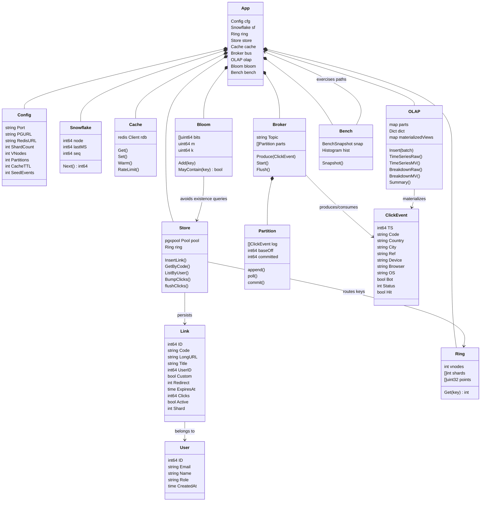
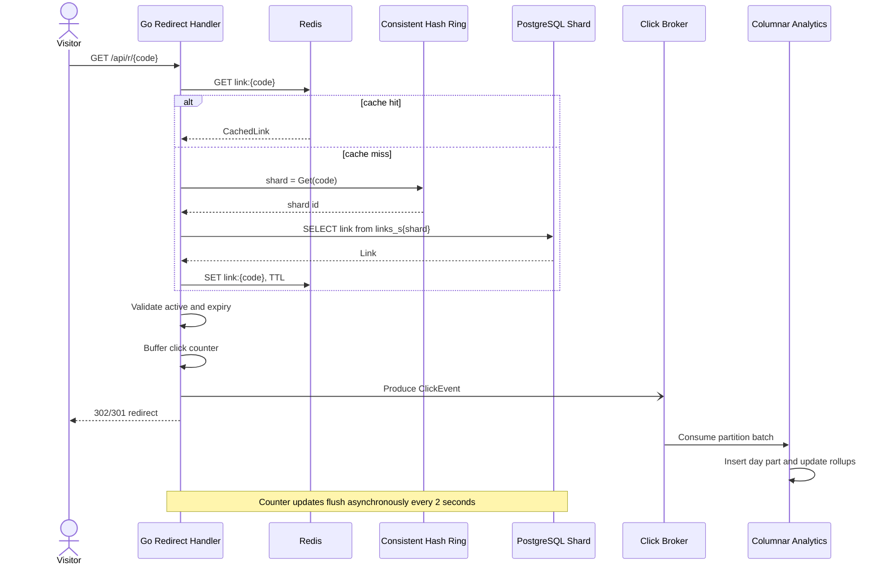
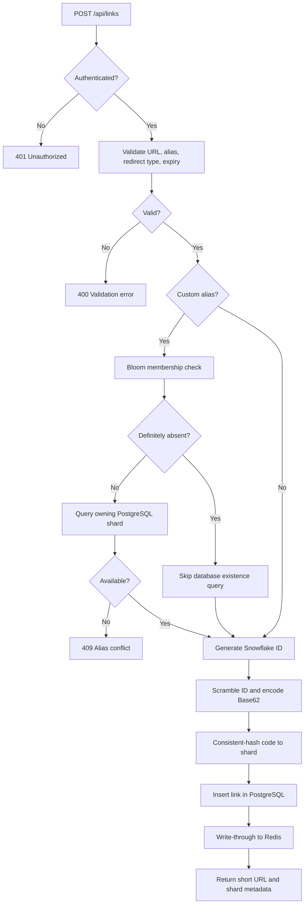

# Architecture

This document maps the implementation to the low-level system-design evaluation criteria.

## Architecture at a glance

```text
React console / browser
          |
          v
   Go HTTP API + router
      |          |
      |          +--> Redis: link cache, rate limits, login lockouts
      |
      +--> Consistent-hash ring --> PostgreSQL links_s0 ... links_s3
      |
      +--> Non-blocking click broker --> partition consumers
                                      |
                                      v
                         columnar day partitions + rollups
```

The default deployment uses four logical PostgreSQL shards, four click-event partitions, Redis 7, PostgreSQL 15, a Go 1.24 backend, and a React 19 frontend. The system is packaged as a multi-stage Docker image and can be started with Docker Compose.

## 1. Requirement Analysis

### Actors

| Actor | Responsibilities |
|---|---|
| Anonymous visitor | Resolve a short code, receive a redirect, or request a QR code. |
| Registered user | Create, list, inspect, disable, delete, and analyze owned links. |
| Operator | Inspect health, cache, shard, broker, runtime, and OLAP statistics. |
| Benchmark client | Generate redirect load or synthetic click events and collect metrics. |
| Background workers | Flush click counters, consume event partitions, merge columnar parts, and maintain rollups. |

### Functional requirements

1. Register and authenticate users with access and refresh tokens.
2. Create short links from HTTP/HTTPS URLs with optional custom aliases, redirect types, titles, and expiry times.
3. Resolve a short code with low latency and return the configured redirect response.
4. Track click events without blocking the redirect response.
5. Expose link-level and account-level analytics by time, geography, referrer, device, browser, operating system, and bot status.
6. Support QR-code generation, link activation/deactivation, deletion, and alias availability checks.
7. Expose operational statistics and an interactive lab for Snowflake IDs, consistent hashing, and Bloom filters.
8. Provide built-in redirect and event-ingestion benchmarks.

### Non-functional requirements

- Low redirect latency: Redis should serve the normal read path; PostgreSQL is the fallback.
- High read throughput: redirects must not synchronously update PostgreSQL.
- Eventual analytics consistency: click counters and analytics may lag redirects by a bounded amount.
- Deterministic partitioning: link ownership must map to exactly one shard.
- Correctness: IDs and short-code mappings must be collision-free and reversible.
- Resilience: event-buffer pressure is bounded and observable; dependency startup is retried.
- Security: passwords are bcrypt-hashed; browser sessions use HttpOnly, SameSite=Lax cookies with single-use rotating refresh tokens; CORS is allowlisted; login and registration are rate limited per client IP; forwarded-for headers are trusted only from configured proxies.
- Operability: cache hit rate, broker lag, dropped events, query timings, runtime memory, and shard distribution are observable.

## 2. Class / Type Diagram

Go does not provide class inheritance. Kortex uses structs for state, methods for behavior, interfaces for polymorphism, and composition for relationships.



### Relationship and multiplicity summary

- One `App` composes one runtime `Config`, `Snowflake`, `Ring`, `Store`, `Cache`, `Broker`, `OLAP`, `Bloom`, and `Bench`.
- One `Broker` owns four or more `Partition` instances, configurable through `BUS_PARTITIONS`.
- One `User` owns zero or more `Link` records.
- Each `Link` is routed to exactly one logical PostgreSQL shard by `Ring.Get(code)`.
- One `ClickEvent` belongs to one short-code stream and is consumed by exactly one broker partition selected by hash.
- `OLAP` stores many click events in day partitions and maintains multiple aggregate maps.

## 3. Object-Oriented Design

### Abstraction

- `rnd` abstracts random-number generation so production request enrichment can use lock-free `math/rand/v2`, while deterministic paths use `math/rand.Rand`.
- HTTP handlers depend on domain operations such as `resolve`, `Store.GetByCode`, `Cache.Get`, and `OLAP.TimeSeriesMV` rather than embedding all storage logic in routes.
- `ClickEvent`, `Link`, `User`, `RingReport`, and benchmark snapshots are explicit domain structures.

### Encapsulation

- Ring internals (`points`, `owner`) are private and accessed through `Get`.
- Cache statistics and broker counters use atomic fields and controlled methods.
- Partition offsets are protected by a mutex and changed through `append`, `poll`, and `commit`.
- Password hashing, token parsing, authorization, and cookie handling are centralized in `auth.go`.

### Inheritance and polymorphism

Go deliberately avoids class inheritance. The equivalent design is interface satisfaction and composition:

- `*rand.Rand` and `fastRand` both satisfy the `rnd` interface.
- HTTP middleware composes CORS, recovery, authentication, and redirect counting.
- Raw-scan and materialized-view analytics implement the same conceptual query operation and are selected by the `mode` request parameter.

## 4. SOLID Principles

| Principle | Application in Kortex |
|---|---|
| Single Responsibility | `Cache` handles Redis, `Store` handles PostgreSQL, `Ring` handles routing, `Broker` handles event delivery, `OLAP` handles analytics, and handlers translate HTTP. |
| Open/Closed | New analytics dimensions can be added through OLAP dimension maps; new benchmark kinds can be added without changing the transport contract. |
| Liskov Substitution | Any implementation of `rnd` can be supplied to request enrichment without changing its behavior contract. |
| Interface Segregation | Small interfaces such as `rnd` avoid forcing callers to depend on unrelated methods. |
| Dependency Inversion | `App` wires dependencies at startup; handlers call domain components instead of managing SQL, Redis protocol, or partition internals. |

## 5. Design Patterns

| Pattern | Where it appears | Why it is used |
|---|---|---|
| Dependency Injection / Composition Root | `main.go` constructs `Config`, `Ring`, `Store`, `Cache`, `Broker`, `OLAP`, and `Bench`. | Centralizes wiring and makes dependencies explicit. |
| Strategy | `mode=raw` versus `mode=mv` analytics execution. | Allows the same endpoint to compare full scans with pre-aggregated queries. |
| Producer-Consumer | `Broker.Produce`, partition dispatch, and partition consumers. | Decouples redirect latency from analytics persistence. |
| Observer / Publish-Subscribe | Redirects publish `ClickEvent` values; consumers react asynchronously. | Allows analytics consumers to evolve independently of redirects. |
| Repository | `Store` methods such as `InsertLink`, `GetByCode`, `ListByUser`, and `DeleteLink`. | Encapsulates SQL and shard-table selection. |
| Cache-Aside | `resolve` checks Redis, falls back to PostgreSQL, then repopulates Redis. | Reduces database reads while retaining PostgreSQL as source of truth. |
| Object Pool | Redis and PostgreSQL connection pools. | Reuses connections and bounds resource consumption. |
| Builder-style Pipeline | `Cache.Warm` uses a Redis pipeline. | Reduces round trips during startup cache warming. |
| Adapter | HTTP handlers adapt JSON requests into domain calls and domain results into JSON. | Separates transport from business logic. |

Kortex does not use a Singleton or inheritance hierarchy because process-wide mutable singletons and class inheritance would make lifecycle, testing, and dependency ownership less explicit in Go.

## 6. Sequence and Activity Diagrams

### Short-link redirect sequence



### Link creation activity


