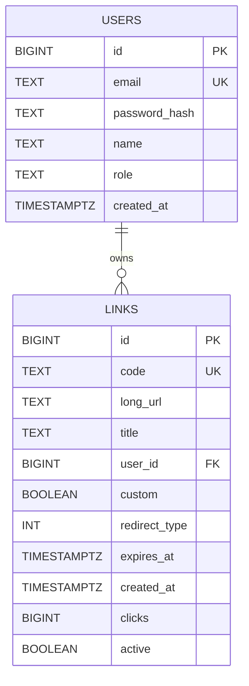

# Database Schema

`LINKS` is physically represented by `links_s0` through `links_s{N-1}`. The `user_id` relationship shown above is a logical ownership relationship; the current migration intentionally keeps users and links in separate tables without a SQL foreign-key constraint. Each shard has a primary key on `id`, a unique constraint on `code`, an index on `(user_id, created_at DESC)`, and point lookups routed directly by `Ring.Get(code)`.

PostgreSQL is the source of truth for users and link metadata. Redis stores serialized `CachedLink` records, rate-limit counters, and failed-login counters. Click history is held in the in-process columnar store in the current implementation; the interfaces are shaped so it can later be replaced with durable storage or an external event system.
